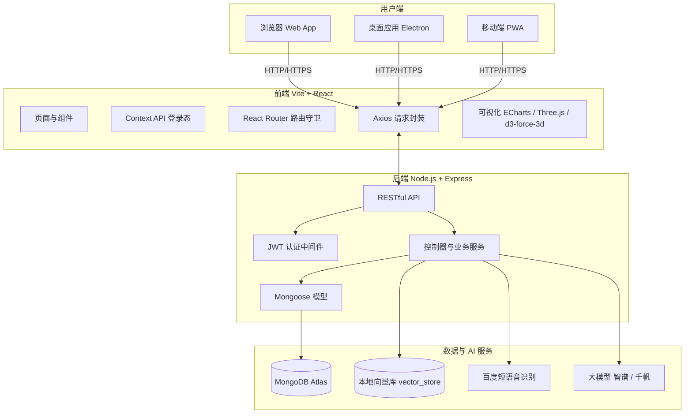

# 费曼学习平台 · 项目总结与汇报

> 《大前端与 AI 实战》实训课程 · 第 16 次课
> 作者：韦丽珍（中南民族大学 计算机学院 软件工程 2403 班）

## 一、项目概述

费曼学习平台是一个「用输出倒逼输入」的 AI 学习工具：用户把知识点写成 Markdown 笔记，再对着麦克风用自己的话复述一遍；系统把录音转成文字，由大模型扮演教练给出润色、优点、待改进与 0–100 分；低于 60 分的知识点自动进入复习列表。平台还提供 AI 出题测评、RAG 私有知识库问答、2D/3D 知识图谱，并能以网页、桌面端（Electron）和移动端（PWA）三种形态运行。

一句话概括：**从「记笔记」到「讲出来」，再到「被追问」，形成一个可闭环的个性化学习系统。**

## 二、技术架构



**请求链路示例（费曼复述）：**

1. 浏览器录音 → Web Audio 解码并重采样为 16kHz 单声道 WAV；
2. `POST /api/audio/transcribe` → 后端换百度 access_token → 调短语音识别 → 返回文本；
3. 用户核对文本 → `POST /api/audio/evaluate` → 后端并行调用大模型「润色」与「评价」；
4. 评价结果写回知识点的 `lastAttempt`，分数 < 60 时更新 `reviewList / status`；
5. 前端展示评分，仪表盘卡片变红，形成复习闭环。

## 三、课时完成情况

| 课时 | 内容 | 主要产物 | 状态 |
| --- | --- | --- | --- |
| 1–3 | 后端基石 | Express 服务、MongoDB 模型、JWT 注册登录、知识点 CRUD | 完成 |
| 4 | 前端起航 | Vite + React、路由、登录/注册页面 | 完成 |
| 5 | 前后端联调 | CORS、Axios 实例与 token 拦截器、全局登录态、路由守卫 | 完成 |
| 6 | 知识点管理 | 增删改查、Markdown/公式/流程图渲染、XSS 双层消毒 | 完成 |
| 7 | 费曼复述 | 浏览器录音、WAV 转码、百度语音转写、可编辑文本 | 完成 |
| 8 | AI 教练 | 润色 + 评价 + 打分、结果落库、复习状态联动 | 完成 |
| 9 | AI 出题测评 | 难度/题型选择、单选与简答、语音作答、AI 阅卷、错题入复习 | 完成 |
| 10 | RAG 基础 | 文本分割、Embedding、本地向量库、知识点增删改自动索引 | 完成 |
| 11 | RAG 问答 | 检索 → MCP 结构化 Prompt → 生成、引用来源、防幻觉 | 完成 |
| 12 | 知识图谱 | 后端引用边接口、ECharts 力导向图、状态着色、点击跳详情 | 完成 |
| 13 | Three.js 入门 | 3D 视界：知识星球、星际航线、悬停高亮、旋转立方体演示 | 完成 |
| 14 | Three.js 进阶 | 3D 知识宇宙：d3-force-3d 力导向布局、点击信息浮层、关联高亮 | 完成 |
| 15 | 跨平台 | Electron 主进程与原生菜单、PWA manifest + Service Worker | 完成（未产出安装包） |
| 16 | 总结与部署 | 项目总结、Dockerfile、Nginx、docker compose、汇报材料 | 完成 |

## 四、关键技术点

### 1. RAG 私有知识库（课时 10–11）

- **分割**：复刻 `RecursiveCharacterTextSplitter` 的递归策略（段落 → 句子 → 字符），`chunkSize=500`、`chunkOverlap=50`，单知识点最多 60 块。
- **向量化**：优先走 OpenAI 兼容的 `/embeddings`（智谱 `embedding-2`，1024 维），未配置时回退千帆 `embedding-v1`。
- **存储**：`vector_store/store.json` 本地持久化，写入串行化 + 临时文件改名，避免并发写坏。
- **检索**：余弦相似度取 Top-4，低于 0.35 视为不相关直接丢弃；按 `userId` 过滤，实现多用户隔离。
- **生成**：用 `<role> / <instruction> / <context> / <question>` 划分上下文的 MCP 风格 Prompt，明确「资料没有就直说不知道」；知识库为空时不调用模型，直接拒绝，防幻觉双保险。
- **引用来源**：响应携带知识点 id、标题、相似度与摘要，前端渲染成可点击 chips。

### 2. 3D 可视化（课时 13–14）

- **课时 13 `/3d-world`**：Three.js 三要素（Scene / PerspectiveCamera / WebGLRenderer）+ OrbitControls；每个知识点一颗带光晕与轨道环的星球（颜色 = 学习状态），引用关系用弯曲的 `THREE.Line` 弧线连接；`CSS2DRenderer` 让标题标签始终保持屏幕字号；`Raycaster` 悬停高亮星球与相连航线，点击（位移 < 5px）跳详情。
- **课时 14 `/universe`**：`d3-force-3d` 三维力导向——电荷斥力、中心力、链接弹簧；模拟由页面自己的 `requestAnimationFrame` 驱动，收敛后停止；节点带动态光晕和 CSS2D 标签，所有航线升级为实时更新的发光弧线；点击弹出 React 信息浮层（替代 `alert`），显示标题、状态、摘要并可跳详情。
- **深空氛围**：程序化星尘粒子、星云柔光、星系轨道环与冷暖双色点光，配合 ACES 色调映射，让 3D 场景更接近「知识星系」而不是几个孤立的球。

### 3. 跨平台（课时 15）

- **Electron**：主进程（Node 环境）创建窗口与原生菜单；渲染进程（Chromium）跑 React。`nodeIntegration: false`、`contextIsolation: true`、`sandbox: true`；只用权限处理放行麦克风，站外链接交给系统浏览器。
- **路由适配**：`file://` 下 history 路由失效，`main.jsx` 检测协议自动切 `HashRouter`；Electron 构建用 `vite build --base ./` 生成相对路径资源。
- **PWA**：`vite-plugin-pwa` 生成 `manifest.webmanifest` 与 `sw.js`，Workbox 预缓存 129 个文件（约 7.5MB）；`navigateFallback=/index.html` 支持离线打开 SPA；`/api` 排除在回退之外；Service Worker 只在生产 + http(s) 环境注册。

### 4. 安全与稳定性

- **XSS**：`react-markdown` 默认不解析原始 HTML，再显式 `skipHtml`；Mermaid SVG 用 DOMPurify 白名单消毒；后端入库前删除代码块之外的原始 HTML，形成「入库 + 渲染」两层防护。
- **模型 JSON 容错**：去代码围栏、截取首尾花括号、修复未转义换行/LaTeX 反斜杠/多余逗号，失败自动重试一次。
- **数据库抖动**：`dbGuard` 在连接未就绪时快速返回 503，首次连接失败重试 5 次，网络异常映射为中文提示，避免「密码错误」误报。

## 五、开发中遇到的问题与解决

| 问题 | 原因 | 解决 |
| --- | --- | --- |
| 音频上传后后端收到空请求体 | axios 在 `Content-Type: application/json` 下把 FormData 序列化成 JSON | Axios 实例不设默认 JSON 头，让浏览器自动生成 multipart boundary |
| 百度语音返回 3300/3311 | 参数放进了 JSON body | token/cuid/dev_pid/format/rate/channel 放 URL 参数，body 直接发原始音频字节 |
| 录音格式不被识别 | 浏览器输出 `audio/webm;codecs=opus` | Web Audio 解码 + `OfflineAudioContext` 重采样 16kHz 单声道 + 手写 WAV 头 |
| 模型输出不是合法 JSON | 中文模型常包代码块、加解释、含 LaTeX 反斜杠 | `parseLlmJson` + `repairJsonText` + 重试一次，仍失败返回 502 |
| 润色把学生答案改成标准答案 | 润色 Prompt 带了知识点正文 | 润色只给术语表并禁止照抄，完整知识点只给「评价」请求 |
| 登录失败误报密码错误 | Atlas 选主节点慢，查询挂到超时后返回 500 | dbGuard 快速 503 + 连接重试 + 网络异常单独映射 |
| Electron 里路由 404 | `file://` 不支持 history 路由 | 按协议切换 HashRouter，构建用相对 base |
| Electron 打包后资源 404 | Vite 默认绝对路径 `/assets` | `vite build --base ./` |
| `electron.js` 报 `require is not defined` | 前端 `"type": "module"` | 主进程改用 `electron.cjs`（CommonJS） |
| Docker 镜像里 bcrypt 编译失败风险 | 依赖了未使用的原生 `bcrypt` | 移除该依赖，统一使用纯 JS 的 `bcryptjs` |

## 六、容器化部署方案

### 目录与职责

```text
feynman-platform-frontend/
├── Dockerfile            # 多阶段：Node 构建 → Nginx 托管 dist
├── nginx.conf            # SPA 回退、/api 反代、静态缓存、gzip
├── docker-compose.yml    # frontend + backend 两个服务
└── docs/项目总结与汇报.md

feynman-platform-backend/
├── Dockerfile            # node:20-alpine，npm ci --omit=dev
└── .dockerignore         # 排除 node_modules/.env/vector_store
```

### 一键启动

```bash
# 1. 准备后端环境变量
cd feynman-platform-backend
cp .env.example .env        # Windows: copy .env.example .env
# 填写 MONGO_URI、JWT_SECRET、BAIDU_*、LLM_* 等

# 2. 在 frontend 目录启动两个容器
cd ../feynman-platform-frontend
docker compose up -d --build

# 3. 访问
# 前端 http://localhost:8080
# 后端健康检查 http://localhost:3000/
```

### 生产环境要点

1. **同源部署**：浏览器只访问 Nginx 的 80/443，`/api` 由 Nginx 转发到 `backend:3000`，因此前端构建参数 `VITE_API_BASE_URL=/api`，不需要处理跨域。
2. **向量库持久化**：`vector_store` 挂载命名卷，容器重建不会丢 RAG 索引。
3. **HTTPS**：PWA 的 Service Worker 要求安全上下文；线上需在 Nginx 配置证书（或由云厂商负载均衡卸载 TLS），`localhost` 调试除外。
4. **端口收敛**：云上可删除 backend 的 `ports` 映射，只保留内网 `expose`，避免 3000 直接暴露公网。
5. **非容器方案**：后端 `npm ci --omit=dev` 后用 PM2 `pm2 start index.js --name feynman-backend && pm2 save`；前端 `npm run build` 后把 `dist` 交给 Nginx 静态托管，配置与 `nginx.conf` 同理。

> 本机未安装 Docker，因此本次只完成部署文件与配置，未实际执行 `docker build`。验证方式：安装 Docker Desktop 后执行 `docker compose config` 检查配置，再 `docker compose up -d --build`；前端镜像构建时会自动执行 `npm run build`，成功即说明 Dockerfile 可用。

## 七、现场演示脚本（约 5 分钟）

| 时间 | 操作 | 讲解要点 |
| --- | --- | --- |
| 0:00–0:30 | 注册/登录，进入仪表盘 | JWT 存 localStorage，路由守卫拦截未登录 |
| 0:30–1:30 | 新建知识点：Markdown 标题 + 公式 + 流程图 | 前端 KaTeX/Mermaid 渲染，后端入库消毒防 XSS |
| 1:30–3:00 | 打开知识点 → 录音复述 → 转写 → 核对文本 → 提交 AI 教练 | 16kHz WAV 转码、百度 ASR、润色与评价并行、分数落库、<60 进复习 |
| 3:00–3:50 | AI 出题：选「困难 + 简答」→ 语音作答 → AI 阅卷 | 结构化出题/阅卷、答错自动加入复习列表 |
| 3:50–4:30 | AI 助手提问知识库没有的内容，再问有的内容 | 先拒绝编造，再给带引用来源的回答，点击 chip 跳详情 |
| 4:30–5:00 | 知识图谱 → 3D 知识宇宙 → Electron 窗口/PWA 安装 | 2D/3D 双视图、力导向布局、桌面与移动端触达 |

**演示前检查清单：**

- [ ] 后端已启动，MongoDB 连接正常（`GET /` 返回 Hello）
- [ ] 账号已提前注册，至少准备 4–5 个有引用关系的知识点
- [ ] 麦克风权限已授权，录音音量正常
- [ ] 大模型额度充足（免费模型高峰可能限流，备一条已保存的评价记录）
- [ ] 浏览器缩放 100%，关闭无关标签页

## 八、汇报提纲

1. **项目定位（30s）**：解决「看得懂但讲不出来」，用费曼输出 + AI 反馈 + 复习闭环。
2. **架构（1–2min）**：前端 React/Vite，后端 Express/MongoDB，AI 层百度语音 + 大模型 + 本地向量库；三端共用一套前端。
3. **演示（3min）**：按上一节脚本，优先展示「录音 → 评分 → 复习」和「RAG 引用来源」。
4. **技术亮点（1min）**：RAG 防幻觉双保险、结构化阅卷、3D 力导向、Electron/PWA 一套代码三端运行。
5. **难点与解决（1min）**：音频格式、模型 JSON 容错、Electron 路由、容器化依赖。
6. **心得与改进（1min）**：
   - 心得：从「功能堆叠」转向「数据流闭环」，学会先定接口再写页面；
   - 改进：接入流式语音识别、把向量库换成真正的向量数据库、补自动化测试与 CI/CD。

## 九、后续可拓展方向

- **AI 深化**：流式输出、多轮追问、错题讲解 Agent、模型微调。
- **可视化深化**：WebGPU、Cesium 数字地球、知识图谱社区发现。
- **工程化**：Vitest 单元测试、Playwright 端到端测试、GitHub Actions 自动构建镜像。
- **部署深化**：Kubernetes、对象存储备份、HTTPS 与域名、日志与监控。
